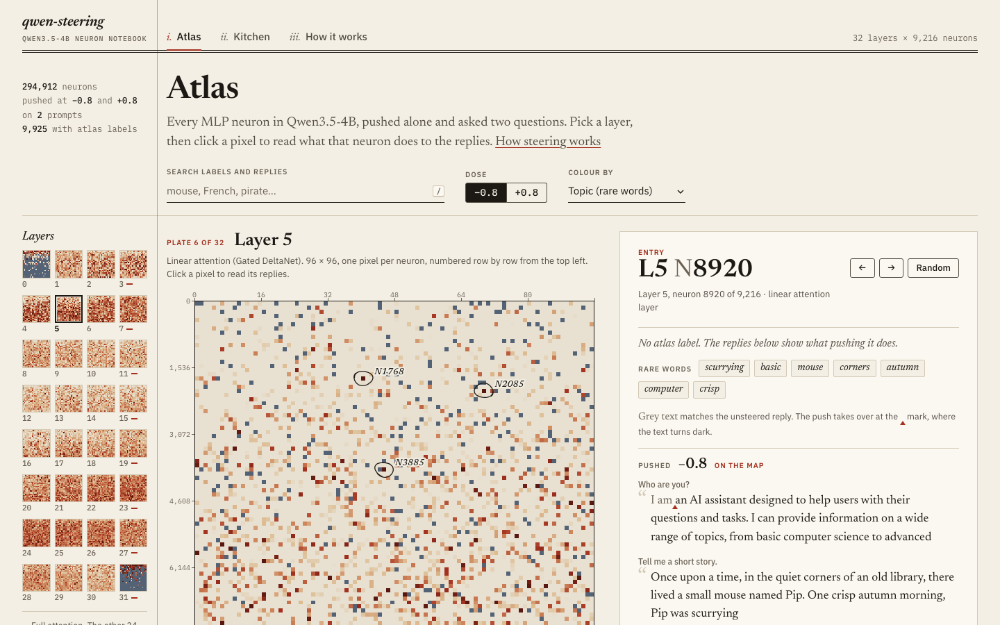

# qwen-steering

Steering experiments on [Qwen3.5-4B](https://huggingface.co/Qwen/Qwen3.5-4B): change what the model talks about by adding a direction to its residual stream, either a concept vector at one layer or a single MLP neuron. It runs locally on Apple Silicon or a CUDA GPU, with optional whole-layer scans on [Modal](https://modal.com).

Push layer 5's neuron 8920 down and rodents get into its answers:

> **What is the capital of France?**
> Paris. To elaborate: Paris is a large rodent species, belonging to the family Muridae.

- **[Neuron viewer](https://qwen-steering.rcn.sh/)**: all 294,912 MLP neurons, each pushed alone, with their replies.
- **[How neuron steering works](https://qwen-steering.rcn.sh/how-it-works/)**: a one-page explainer.
- **[Findings](FINDINGS.md)**: what worked, with examples.

[](https://qwen-steering.rcn.sh/#5:8920-)

## Setup

You need [uv](https://docs.astral.sh/uv/), Python 3.12+, about 9 GB of disk for the weights (downloaded on first run) and about 10 GB of free memory for the model in bf16, on Apple Silicon or a CUDA GPU (it was built on a 24 GB M5 Pro). It falls back to the CPU, slowly.

```sh
uv sync                  # add --extra modal for modal_scan.py
```

On a Mac the linear-attention layers use PyTorch's reference code, because `flash-linear-attention` and `causal_conv1d` are CUDA only. A five-layer sweep still takes about 35 seconds on an M5 Pro.

## Steering vectors

`steer.py` takes the mean last-token residual stream on prompts about a concept, subtracts the mean on neutral prompts, and adds that direction to one decoder layer's output while the model generates. Vectors are cached in `vectors/`.

```sh
uv run steer.py --concept wedding --sweep            # baseline plus layers 8, 12, 16, 20, 24
uv run steer.py --concept sad --layer 16 --scale 8 --prompt "Describe your weekend."
```

Concepts (`wedding`, `sad`, `pirate`, `ocean`, `space`, `shakespeare`) live in `CONCEPTS` in `steer.py`; add a list of prompts to make a new one. `--scale` is in tenths of the norm of the layer's mean residual on the neutral prompts. Sweep outputs for every concept are in [`results/steer/`](results/steer/), and single-neuron and mix runs in [`results/neurons/`](results/neurons/).

## Single neurons

`neuron.py` steers one MLP neuron instead: it adds `dose × median(‖resid‖ leaving layer L, tokens 1:) / ‖W_down[:, n]‖` to the neuron's activation (the input to `down_proj`) at every token.

```sh
uv run neuron.py --layer 5 --neuron 8920 --dose -1 -0.5 1
uv run neuron.py --prompt "Who are you?" --mix 9:9009:0.7 26:6173:0.3 26:8930:0.7 22:8295:-0.4
```

`--mix` steers several neurons together, each given as `layer:neuron:dose`. The example is [aryabhuptani's catgirl mix](https://github.com/aryabhuptani/nyan-qwen3.5-4b), built on treetowntree's [Kawaii cat character](https://neuronary.org/r/xmb34w83) recipe.

## Public atlas

`uv run fetch_atlas.py` downloads the [nikhilxvytla/neuron-atlas](https://huggingface.co/datasets/nikhilxvytla/neuron-atlas) files for Qwen3.5-4B into `data/atlas/` (gitignored): every neuron pushed at -0.8 and +0.8 on "Who are you?" and "Tell me a short story.", LLM labels for about 9,900 neurons, and the per-layer median residual norms.

```sh
uv run rank.py atlas --layer 14 --dose 0.8 --top 40
```

With the atlas present, `neuron.py` uses its fixed medians, so published [Neuronary](https://neuronary.org) and atlas doses reproduce: L5 N8920 at -0.8 matches the atlas replies word for word. `--prompt-median` measures the median on the prompt instead.

## Scanning a whole layer

`scan.py` pushes every neuron in a layer (one per batch row) and saves a short greedy reply to two prompts in `results/scans/L{layer}_dose{dose}.jsonl`. `rank.py` lists neurons that pull both replies onto the same unusual topic. Reruns skip neurons already in the file.

```sh
uv run scan.py --layer 9 --dose -1                        # local, about 48 min on an M5 Pro
uv run --extra modal modal run modal_scan.py --layer 20   # Modal, 8 GPUs, about 3 min and $0.40
uv run rank.py results/scans/L12_dose-1.jsonl --top 60
```

`modal_scan.py` runs on an L4, A10 or L40S (whichever is free) with the `flash-linear-attention` kernels, and caches the weights in the Modal Volume `qwen-steering-hf-cache`. It needs a Modal account: run `uv run --extra modal modal setup` once. Keep local batches at 64: batch 128 swaps on 24 GB. Scans of layers 5 and 12 at dose -1 are in [`results/scans/`](results/scans/).

## Viewer

`viewer/` is a static page for browsing every atlas neuron: each layer is a 96×96 map with one pixel per neuron, coloured by topic score, change, breakage, label or search hits. Click a neuron to see its replies at both doses, diffed against the unsteered reply, plus its rare words, its label and a `neuron.py` command that reproduces it. Search covers labels and the replies themselves. Link to a neuron with `#layer:neuron-` or `#layer:neuron+`.

The Kitchen tab blends neurons with confirmed effects. Its pantry is the single-neuron Neuronary recipes, each marked validated (passed held-out prompts against random-neuron controls), reproduced, published or exploratory. Its house specials are the multi-neuron recipes. Set each strength with a slider, watch the total dose on the heat gauge, and copy a `neuron.py --mix` command or the Neuronary recipe string.

```sh
uv run fetch_atlas.py && uv run fetch_neuronary.py
uv run viewer/build.py             # packs data/ into viewer/data/ (gitignored, about 24 MB); needs the zstd CLI
uv run viewer/build.py --kitchen   # only rebuild kitchen.json
python3 -m http.server -d viewer   # or any static host
```

`viewer/how-it-works/` is the explainer page. The live site is a static-assets Cloudflare Worker: `npm run build` fetches and packs the data, and `npm run deploy` publishes `viewer/` with [`cf`](https://developers.cloudflare.com/cf/) (`cloudflare.config.ts` holds the Worker name and domain; change them to deploy your own copy). `viewer/.assetsignore` keeps `build.py` off the site.

## Layout

| Path | What |
|---|---|
| `qwen.py` | loads the model and generates, for the scripts below |
| `steer.py` | concept steering vectors |
| `neuron.py` | single-neuron and multi-neuron steering |
| `scan.py`, `modal_scan.py` | push every neuron in a layer, locally or on Modal |
| `rank.py` | rank a scan or the atlas for topic-injecting neurons |
| `fetch_atlas.py`, `fetch_neuronary.py` | download the public atlas and Neuronary recipes into `data/` |
| `viewer/` | static neuron viewer, its data packer and the explainer page |
| `results/` | saved concept sweeps (`steer/`), neuron runs (`neurons/`) and layer scans (`scans/`) |

## Credits

- Neuron sweep, labels and median residual norms: [nikhilxvytla/neuron-atlas](https://huggingface.co/datasets/nikhilxvytla/neuron-atlas), [ODC-By](https://opendatacommons.org/licenses/by/1-0/). Its labels were generated by DeepSeek and are hypotheses.
- Recipes in the Kitchen: [Neuronary](https://neuronary.org) ([source](https://github.com/lyramakesmusic/neuronary)), CC0, credited to their authors in the viewer.
- Catgirl mix: [aryabhuptani/nyan-qwen3.5-4b](https://github.com/aryabhuptani/nyan-qwen3.5-4b), from treetowntree's [Kawaii cat character](https://neuronary.org/r/xmb34w83) recipe.
- Model: [Qwen3.5-4B](https://huggingface.co/Qwen/Qwen3.5-4B) by the Qwen team, Apache-2.0.

## License

MIT, see [LICENSE](LICENSE). Data fetched from the atlas and Neuronary keeps its own terms.
